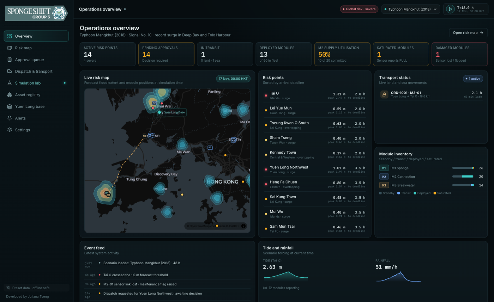

# SPONGE SHIFT GROUP 3

**Storm surge & flooding — modular infrastructure deployment platform for Hong Kong.**

A working browser prototype for planning, approving and dispatching modular sponge (M1), connection (M2)
and breakwater (M3) units ahead of storm surge and pluvial flooding. Built for RECO4012 Studio 6 —
*Smart and Sustainable Urban Development*.



---

## What it does

| View | Purpose |
| --- | --- |
| **Overview** | Risk KPIs, sensor health, risk list sorted by deadline, transport feed, inventory mix, event log |
| **Risk map** | Flood forecast layer, risk pulses, approval card, layer control, 48 h timeline scrub |
| **Approval queue** | Recommendation detail, tide/prediction charts, time-window feasibility verdict, M2 recall conflict |
| **Dispatch & transport** | Road/sea routes, rolling 12 h deployment timeline, fleet capacity, M2 dual-use panel |
| **Simulation lab** | Preset and custom scenarios, drag-to-deploy with snap grid, time-to-saturation, with/without comparison |
| **Asset registry** | 60 modules, sensor status, fill level, batch recovery, deep-linked detail |
| **Yuen Long base** | Storage zones, dispatchable count, launch point status, movement log |
| **Alerts** | Filterable feed with jump links into the registry and risk map |
| **Settings** | Fleet inventory, transport speeds, live API table with per-endpoint tests, custom scenario builder |

### Module specifications

| Module | Shape | Footprint | Height | Environment | Role |
| --- | --- | --- | --- | --- | --- |
| **M1 Sponge** | Hexagon | 15 m dia · 145 m² | 3.5 m | Coastal land + nearshore sea | Absorption & filtration |
| **M2 Connection** | Rectangle | 9 × 2 m · 18 m² | 3.5 m | Territory-wide land | Water storage + barrier linkage (dual use) |
| **M3 Breakwater** | Hexagon | 15 m dia · 145 m² | 6.5 m | **Sea only** | Wave attenuation, floating, sea tow |

M3 dropped on land is rejected with a red preview and a `M3 Restricted to Sea` tooltip.

---

## Run locally

```bash
npm install
npm run dev          # http://localhost:5173
```

```bash
npm run typecheck    # tsc --noEmit
npm run build        # production bundle in dist/
npm run preview      # serve the built bundle
```

Node 18+ is required. No API keys, no backend, no database — the app is a static bundle.

---

## Deploy to GitHub Pages (3 steps)

1. **Create the repository** on GitHub (public or private), then push this folder:

   ```bash
   git init
   git add .
   git commit -m "SPONGE SHIFT GROUP 3 deployment platform"
   git branch -M main
   git remote add origin https://github.com/<your-username>/<your-repo>.git
   git push -u origin main
   ```

2. **Turn on Pages**: repository → **Settings** → **Pages** → *Build and deployment* →
   **Source: GitHub Actions**.

3. **Wait for the run.** The included workflow (`.github/workflows/deploy.yml`) builds and publishes on
   every push to `main`. The site appears at
   `https://<your-username>.github.io/<your-repo>/` in about a minute.

No `basePath` editing is needed: Vite is configured with `base: './'`, so the same build works on a
project page, a user page (`<user>.github.io`), a custom domain, or `file://`.

---

## Live data sources

All endpoints are public, key-free and were verified with `curl` (HTTP 200) on 17 Nov 2026.
The **Settings → API connections** panel runs the same requests from your browser, so you can
re-test them at any time.

| Source | Endpoint | CORS | Notes |
| --- | --- | --- | --- |
| HKO weather warnings | `data.weather.gov.hk/weatherAPI/opendata/weather.php?dataType=warningInfo&lang=en` | `*` | Returns `{}` when no warning is active |
| HKO rainfall (rhrread) | `.../weather.php?dataType=rhrread&lang=en` | `*` | District rainfall, past hour |
| HKO tide (Tai O, hourly) | `.../opendata/opendata.php?dataType=HHOT&station=TAO&year=YYYY&month=M&day=D&rformat=json&lang=en` | `*` | Predicted astronomical tide |
| DATA.GOV.HK flooding blackspots | `data.gov.hk/en-data/api/3/action/package_search?q=flooding%20blackspots&rows=1` | — | Portal is public but sends no CORS header; the UI shows it as *restricted* and offers an open link |
| Basemap | CARTO Dark Matter via MapLibre GL | `*` | No token required |
| Road routing | OSRM demo server (`router.project-osrm.org`) | `*` | Best-effort; sea legs use digitised lanes; both fall back to a dashed *Indicative* line |

The **scenario menu → Live API** entry switches the whole UI to live tide/rainfall/warnings while keeping
the same approval and dispatch workflow. Preset scenarios stay fully offline.

---

## Project structure

```
src/
  components/   MapView (MapLibre), shared UI, timeline & scenario controls
  views/        Overview, RiskMap, Approval, Dispatch, SimulationLab, Registry, Base, Alerts, Settings
  lib/          geo (grids, snapping, water test), sim (depth, saturation, inventory), routing, api
  data/         module specs + three preset scenarios (Mangkhut, Hato, Black Rainstorm)
  store.ts      Zustand store: scenario boot, approvals, dispatch, sensors, toasts
public/brand/   logo lockups (transparent PNG) and favicon mark
```

State is held in a single Zustand store; scenario JSON is imported statically, so the bundle is
self-contained and works offline after the first load.

---

## Model scope & honest limitations

- **Flood depth is a synthetic model.** Depth per risk point is a parametric curve of tide, rainfall and
  wind, attenuated by nearby deployed modules. It is not a hydrodynamic simulation, and flood polygons
  are depth-scaled blobs rather than DEM-derived inundation extents.
- **Routes are indicative.** The OSRM demo server is rate-limited and not for production; sea lanes are
  hand-digitised straight-ish legs between waypoints.
- **Assets and events are seeded.** The 60 modules, approvals and event log are prototype data, not a
  live fleet. Settings persist to `localStorage` only.
- **Sensor states are simulated** from `simTime`, so the FULL/DAMAGED flows can be demonstrated without
  hardware.

---

## Credits

Designed and built by **Juliana Tseng** for RECO4012 Studio 6 — Smart and Sustainable Urban Development.
Risk locations reference the DSD coastal low-lying and windy residential areas, including the seven
storm-surge spots and three overtopping wave spots used by the Hong Kong Observatory.
